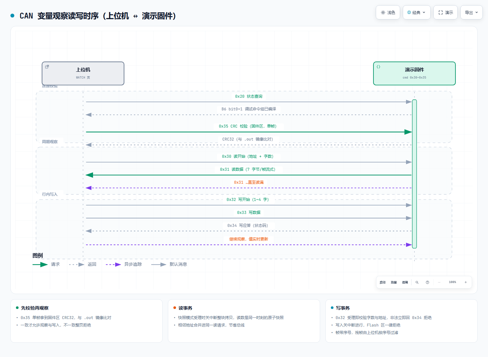
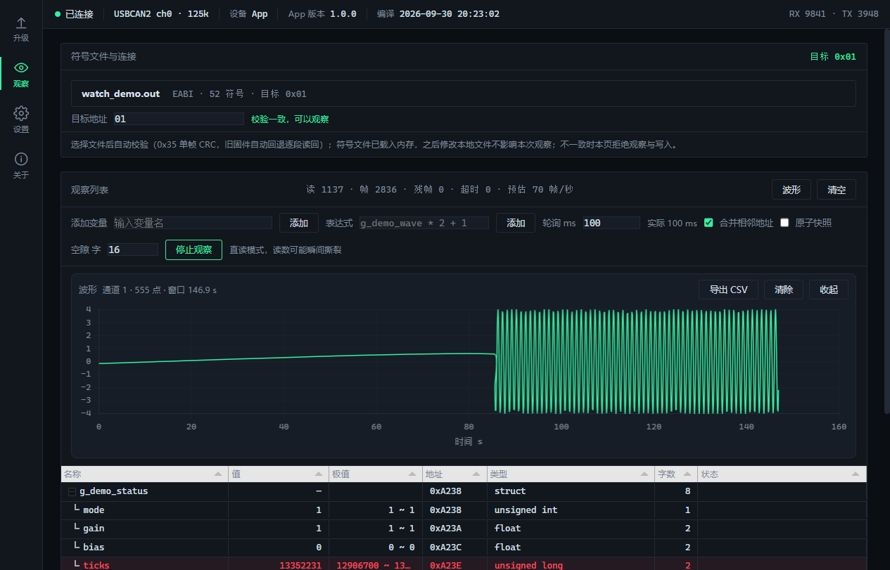

# C2000-CAN-Watch

TI C2000（F28002x 系列，示例芯片 F280025C）的 CAN 总线变量观察固件：上位机通过 0x30~0x35 调试命令组读写设备运行中的 RAM 变量，配合桌面上位机 WATCH 页即可实时观察、绘制波形并在线修改参数，不占用串口、不需要调试器驻留。


## 功能

| 功能 | 说明 |
|---|---|
| 内存读 | 0x30/0x31：单次最多 255 字，支持原子快照与直读两种模式，相邻地址自动合并 |
| 内存写 | 0x32/0x33/0x34：单次 1~4 字，关中断写入，Flash 区拒绝 |
| CRC 快校验 | 0x35：单帧返回固件区 CRC32，上位机与 .out 镜像比对，毫秒级确认符号文件与板上一致 |
| 符号解析 | 上位机直接解析 CCS 输出的 ELF .out（DWARF），结构体/数组/枚举自动展开 |
| 演示变量 | 计数器、运行时间、1 Hz 正弦、可写幅值、演示状态结构体，开箱即可观察 |



## 仓库结构

```
C2000-CAN-Watch/
├── watch_demo/    演示固件 CCS 工程（独立运行，产物 watch_demo.out）
├── demo/          随仓库分发的已编译 watch_demo.out（无 CCS 也能体验上位机）
├── img/           时序图与截图
└── LICENSE
```

工程自包含（CCS 12.6 + ti-cgt-c2000_22.6.1.LTS 验证通过），不依赖 C2000Ware。固件独立链接在 0x080000，用 CCS/DSLite 直接烧录即可运行，不需要 Bootloader。

## 快速开始

1. **烧录**：把 `watch_demo/Flash/watch_demo.out`（或 `demo/` 下随仓库的副本）烧入 F280025C。
2. **连接**：ZLG USBCAN2 接 CAN 总线，125 kbps。
3. **观察**：打开 [CAN Companion](https://github.com/MisakaMikoto128/c2000-can-companion) 上位机 → 观察页 → 选择符号文件 `watch_demo.out` → 自动校验通过后添加变量（如 `g_demo_wave`、`g_demo_status.mode`）→ 开始观察。
4. **写入**：在 `g_demo_setpoint` 行直接改值，正弦幅值随改随变。



## 演示变量

| 变量 | 类型 | 行为 |
|---|---|---|
| `g_demo_counter` | volatile uint32_t | 每毫秒自增 |
| `g_demo_uptime_ms` | volatile uint32_t | 上电毫秒数 |
| `g_demo_wave` | volatile float | 1 Hz 正弦，幅值 = `g_demo_setpoint` |
| `g_demo_setpoint` | volatile float | 正弦幅值，可从上位机写入 |
| `g_demo_status` | volatile struct | mode / gain / bias / ticks，演示结构体展开与成员写入 |

移植时把这些变量换成自己工程里的任意全局变量即可，协议与工具链无需改动。

## 协议摘要

与 Bootloader 同一套五段式帧 ID（`err | dev=0x0C | cmd | dest | src`），数据域小端、DLC=8，调试命令仅收单播。

| cmd | 名称 | 说明 |
|---|---|---|
| 0x30 | 读开始 | B0-3 地址、B4 字数（≤255）、B5 帧间隔、B6 序号、B7 快照/直读 |
| 0x31 | 读数据 | 7 字节/帧流式回传，B0 序号回显 |
| 0x32 | 写开始 | B0-3 地址、B4 字数（1~4）、B5 超时、B6 序号 |
| 0x33 | 写数据 | DLC = 字数×2 |
| 0x34 | 写应答 | B0 序号、B1 状态码（0 成功 / 1 Flash 拒绝 / 2 字数非法 / 3 超时） |
| 0x35 | CRC 校验 | B0-3 地址、B4-5 字数；应答 B0-3 CRC32、B4 状态码 |

完整帧布局见 [docs/协议.md](docs/协议.md)。

## 移植要点

见 [docs/移植指南.md](docs/移植指南.md)。核心三步：换链接脚本与位域头文件、按需收紧 `CAN_DBG_CRC_MAX_WORDS` 校验窗口、把 `main.c` 里的演示循环替换为业务代码（保留 `can_app_poll()` 调用）。

## 配套仓库

- [c2000-can-bootloader](https://github.com/MisakaMikoto128/c2000-can-bootloader) —— CAN Bootloader（与本固件同一套帧 ID 框架，可共存）
- [c2000-can-companion](https://github.com/MisakaMikoto128/c2000-can-companion) —— 桌面上位机（WATCH 页 + 固件升级页）

## 许可

以 [CC BY-NC-SA 4.0](LICENSE)（署名—非商业性使用—相同方式共享 4.0）发布：可自由使用、修改与分发，**不得用于商业目的**；引用源码或思路时请注明作者（Liu Yuanlin）。
